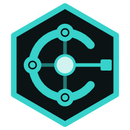

<p align="center">
  
</p>

<h1 align="center">DarkCipher AgentControl</h1>

<p align="center">
  <b>A Windows control plane for agentic AI coding: local models, coding agents and their tools, set up and run safely.</b><br>
  Claude Code · Codex CLI · Ollama · LM Studio · llama.cpp · templates · extensions<br>
  <a href="https://darkciphersystems.com/software.html#agentcontrol">Download</a> ·
  <a href="../../releases/latest">Latest release</a> ·
  <a href="docs/USER-GUIDE.md">User guide</a> ·
  <a href="docs/SECURITY.md">Security</a> ·
  <a href="CHANGELOG.md">What's new</a>
</p>

<p align="center">
  
  
  
  
  
</p>

---

AgentControl is a Windows desktop app by **DarkCipher Systems**. It works out what your PC can run, recommends a local
coding stack, installs the runtime, models and agent tools, configures Claude Code or Codex safely, tests what really
works, and launches and tracks agent sessions. All of it sits behind central security services: protected folders, a
secure process executor, a deny-by-default network policy, Windows Credential Manager and a tamper-evident audit log.
It shares its look with WhisperDesk, MaskedMail and ServerManagement.

## Highlights

- **Quick Setup, automated.** Hardware scan, a recommended stack and model, then the missing runtime and agent are
  installed with winget (per-user, no administrator rights), each after you approve its full plan. Ollama is started if
  it isn't running. Then the model is downloaded and tested.
- **A reviewed catalogue.** Claude Code, Codex CLI and Ollama, plus LM Studio, llama.cpp, Jan and llamafile, the
  gateways built into them, more agent CLIs (GitHub Copilot CLI, OpenCode, Crush, Kilo, Amp) and supporting tools
  (Git, Node.js, Python, uv, ripgrep, fd, jq, GitHub CLI). Every package is pinned, installs per-user, and counts as
  ready only after its post-install test.
- **Real compatibility, not claims.** Models are tested on your PC (text, instructions, code, JSON schema, tool calls),
  and stacks are verified end to end in a throwaway project. A configuration is only labelled **Supported and
  Verified** once all of that passes.
- **Templates and deterministic configuration.** Validated templates connect agent, runtime, model and project; the
  same choices always give the same configuration fingerprint. Configuration changes are transactions, with a backup
  and a rollback.
- **Downloads in one queue.** Models, Hugging Face GGUF imports and tool installs share one queue, with resume, retry
  and a testing stage.
- **Extensions.** SDK 1.1, a bundled gallery of data-only template and model packs, and code extensions behind
  Development Mode (clearly labelled: not isolated).
- **Right-click everything.** Every list has a context menu; crowded ones are grouped into submenus.

## Honest status

- **Beta.** The installer and exe are **not code-signed** yet, so Windows SmartScreen warns. Check every download
  against `SHA256SUMS.txt`.
- **Verified on the build PC:** Codex CLI 0.161.0 + Ollama 0.40.6 + llama3.2 (Code Review template). Claude Code
  through a local gateway is **Experimental**: Anthropic doesn't support it, and small models fail its end-to-end test.
  See [docs/SUPPORTED-CONFIGURATIONS.md](docs/SUPPORTED-CONFIGURATIONS.md).
- Tools marked **Catalogue only** can be installed, updated, detected and removed, but no stack uses them yet.
- The updater is off: no release signing key exists yet.

## Install

Download from [darkciphersystems.com](https://darkciphersystems.com/software.html#agentcontrol) or the
[latest release](../../releases/latest):

- **MSI**: installs to `C:\Program Files\DarkCipher Systems\AgentControl` (one administrator approval).
- **Portable zip**: self-contained, no .NET install needed.

Both are unsigned: check the file against `SHA256SUMS.txt` first (`Get-FileHash <file> -Algorithm SHA256`).

## Documentation

| Guide | For |
|---|---|
| [USER-GUIDE](docs/USER-GUIDE.md) | Using the app |
| [ADMIN-GUIDE](docs/ADMIN-GUIDE.md) | Deployment and administration |
| [SECURITY](docs/SECURITY.md) | Security and threat model |
| [PRIVACY](docs/PRIVACY.md) | Privacy |
| [SUPPORTED-CONFIGURATIONS](docs/SUPPORTED-CONFIGURATIONS.md) | What has been verified, exactly |
| [ARCHITECTURE](docs/ARCHITECTURE.md), [ADRS](docs/ADRS.md) | Architecture and decisions |
| [DEVELOPER-GUIDE](docs/DEVELOPER-GUIDE.md) | Developers |
| [sdk/README](docs/sdk/README.md), [EXTENSIONS](docs/EXTENSIONS.md) | Extensions |
| [TROUBLESHOOTING](docs/TROUBLESHOOTING.md), [RECOVERY](docs/RECOVERY.md) | Problems and recovery |
| [TESTING](docs/TESTING.md), [RELEASE](docs/RELEASE.md) | Testing and releasing |
| [REPORT](docs/REPORT.md) | The status of every feature |
| [CHANGELOG](CHANGELOG.md) | Changes per version |

## Build it

Needs Windows 10/11 x64 and the .NET 8 SDK (`global.json` pins it).

```powershell
dotnet build .\DarkCipherAgentControl.sln -c Release
dotnet test .\tests\DarkCipher.AgentControl.Tests -c Release
```

The full release build (`.\build.ps1`) runs the tests, the vulnerability scan, the self-test, the MSI with its
validation, the SBOM and the checksums. See [docs/RELEASE.md](docs/RELEASE.md).

- `--safe-mode`: built-in components only.
- `--selftest <dir>`: headless checks plus off-screen renders. Requires `DCAC_DATA_DIR` to be set to a scratch folder; see `tools\run-selftest.ps1`.

## Layout

| Path | What |
|---|---|
| `src/` | Domain, Application, Security, Infrastructure, Integrations, Sdk, Extensions, App |
| `tests/` | Unit, security, architecture and SDK-contract tests, plus opt-in live tests |
| `tools/` | `dcx-ext` extension tooling, the icon builder, the self-test runner, the release pipeline |
| `samples/` | Two declarative and two code extension samples |
| `schemas/` | Extension manifest JSON schema |
| `docs/` | Guides, architecture, security, testing, releasing, release notes |

## Data

- **App data:** `%LOCALAPPDATA%\DarkCipher\AgentControl` (config, logs, audit, backups, extensions, agent profiles, test projects).
- **Secrets:** Windows Credential Manager only.

## Licence

MIT, see [LICENSE](LICENSE). Third-party components are listed in each release's `THIRD-PARTY-LICENCES.txt` and SBOM.
